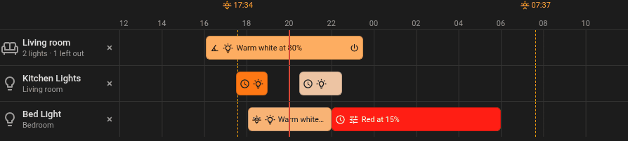
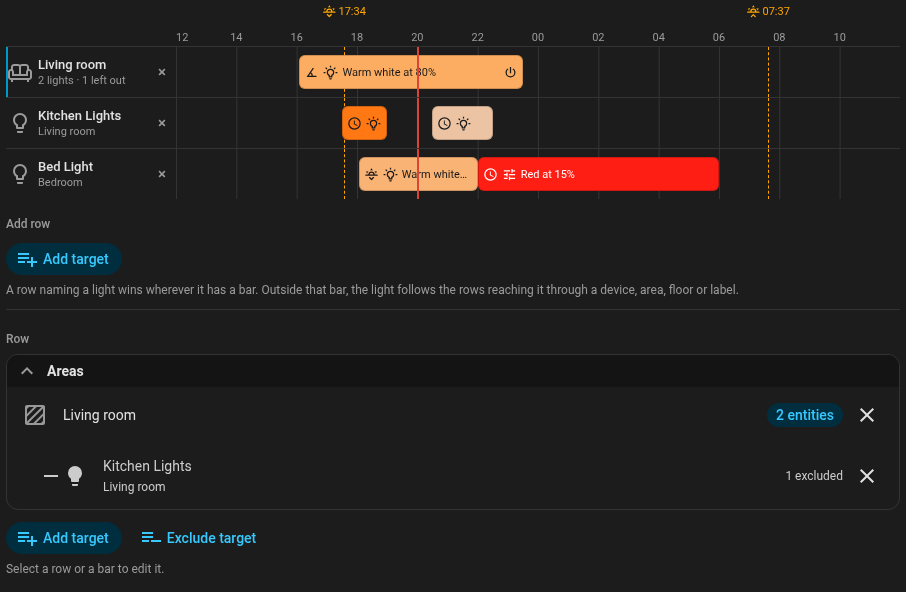
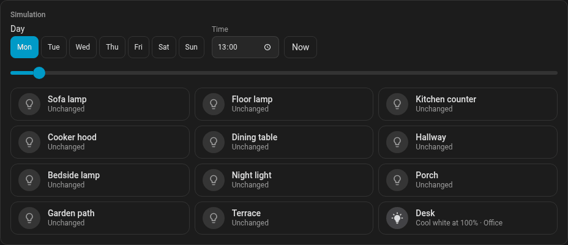
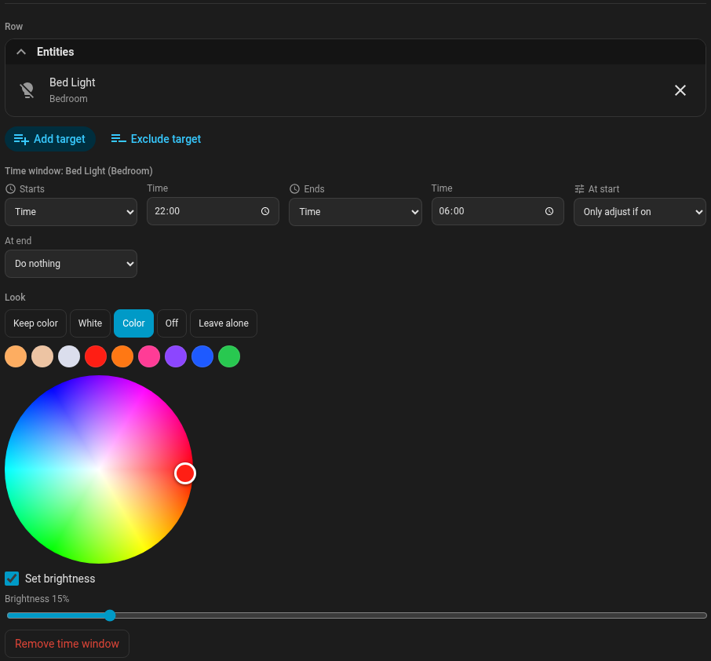

<p align="center">
  
</p>

# Light Planner

[](https://my.home-assistant.io/redirect/hacs_repository/?owner=rhd944dot1&repository=light-planner&category=integration)

[](https://github.com/hacs/integration)
[](https://github.com/rhd944dot1/light-planner/releases)
[](https://github.com/rhd944dot1/light-planner/actions/workflows/validate.yml)
[](https://github.com/rhd944dot1/light-planner/actions/workflows/tests.yml)
[](LICENSE)

Schedule your Home Assistant lights on a visual timeline in the sidebar, without writing automations.

Say your evening lights start at sunset, two more lamps join at 17:30, one goes off at 19:00, and the bedroom turns dim red at 22:00. Light Planner keeps that schedule in one named flow you can see and drag, and when you come home at 20:00 it sets every lamp to what it should be at that moment.



## Features

- **Named flows**: a light schedule such as "Evening light". Each row on the timeline is a target, each bar a time window for it. Lights can join and leave one after another.
- **Drag to edit**: move a bar, drag its edges, click an empty spot to add a time window. On a phone, tap a bar first, then drag its arrows.
- **Home Assistant's own target picker**: lights, devices, areas, floors, labels and scenes, several in one row. A newly labeled light joins on its own. From Home Assistant 2026.11 you can exclude things from a target, such as a device's status LED.
- **Start** at a time, at sunset or sunrise with an offset, or when the sun drops below an elevation, optionally "not before" a time.
- **End** at a time or at sunset or sunrise with an offset, then turn off, restore the previous state, or do nothing.
- **Looks per time window**: white, any color from a color wheel, keep color, off, or leave alone.
- **Weekdays** and **conditions**: anyone, everyone or nobody home, a specific person, or presence doesn't matter.
- **Arriving home** applies whatever is scheduled at that moment, even if you missed the start.
- **Don't touch manually changed lights**: an optional setting per flow leaves lights alone that someone or something else changed.
- **Plain-language summary** of what each flow does, and a **simulation** of what happens when you arrive home at any time.
- **English and German**, following your Home Assistant language.







## Requirements

Home Assistant 2026.10 or newer. Excluding things from a target needs 2026.11, where the picker offers it.

## Installation

### HACS

1. Select the button above, or search for **Light Planner** in HACS. From Home Assistant 2026.11, HACS is built in as the Marketplace.
2. Download **Light Planner** and restart Home Assistant.
3. Go to **Settings > Devices & services > Add integration** and add **Light Planner**.
4. Open **Light Planner** in the sidebar. It's visible to administrators.

### Manually

Copy `custom_components/light_planner` into the `custom_components` folder of your configuration, then continue with step 2 above.

## Removing

Remove **Light Planner** under **Settings > Devices & services**. This also deletes your flows, so make a Home Assistant backup first if you might want them back. Then remove it from HACS and restart Home Assistant.

## Getting started

1. Select **New flow** and give it a name.
2. Under **Add row**, pick a light, device, area, label or scene.
3. Click or tap the row's empty timeline to add a time window, then drag it into place.
4. Select the bar to set its start, end and look.
5. Choose when the flow applies, read **In plain words** to check it does what you mean, and select **Save**.

## How overlapping time windows work

A row naming a light wins wherever it has a bar. Outside that bar, the light follows the rows reaching it through a device, area, floor or label. Among several such rows, and between flows, the time window that started last wins. When it ends, the light goes back to the one still running. A bar's end action only runs for lights nothing else covers.

When you arrive home, every running flow set to *Apply* sets its lights, whatever the time, so lights differ correctly even if you missed the moment a time window started. Time windows set to *Only adjust if on* leave lights alone at their start, but still switch them on when you arrive.

## Manually changed lights

With *Don't touch manually changed lights* on, a flow leaves a light alone if it was changed in the last few hours (1 to 24, set per flow) or while the flow runs. That covers the start of a time window, the change between time windows and arriving home. The end action still runs, so a light you changed still turns off or goes back at the end. The panel lists the lights left alone right now, and you can hand each one back to the flow. *Apply now* always applies and hands the lights back. When the flow's run ends, the lights count as untouched again.

Home Assistant can't reliably tell a person from an automation or a wall switch, so everything that doesn't come from Light Planner counts as a manual change. Lights in a Home Assistant light group can occasionally report a late update that counts too. A scene waits if any of its lights was changed. Scenes run only when picked themselves, not through an area or label.

## Good to know

- After a restart, Light Planner catches up on starts and ends it missed while Home Assistant was off. A time window that began and ended during that time is skipped. A light that isn't available yet right after the restart misses the catch-up.
- *Apply now* applies what the flow schedules for this moment. If no time window is running, nothing happens.
- Leaving home doesn't end a flow. Use a bar's end action or a *Nobody is home* flow.
- Sun moments come from the home location set in Home Assistant. The timeline shows them for the day chosen in the simulation.
- Light Planner schedules lights and scenes only. For locks, garage doors and heating, use automations or a general scheduler.

## Development

```bash
uv venv && uv pip install -r requirements_test.txt
.venv/bin/python -m pytest tests
```

The panel is a plain web component in `custom_components/light_planner/frontend`, without a build step. The logic in `schedule.py` runs without Home Assistant.

## License

[MIT](LICENSE)

---

*Developed with the help of [Claude Code](https://claude.com/claude-code).*
